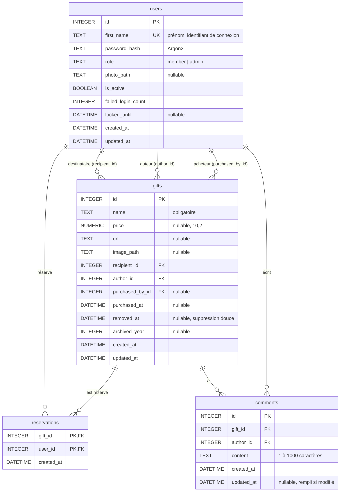

# 03 — Modèle de données

Base **SQLite**, accédée via SQLAlchemy 2, migrations Alembic. Les noms de tables et de colonnes sont en anglais, les écrans et la doc en français (glossaire ci-dessous).

## Schéma



## Glossaire

| Colonne / table | Sens métier |
|---|---|
| `users` | Membres et admin |
| `gifts` | Cadeaux |
| `gifts.recipient_id` | Destinataire (« Pour qui ? ») |
| `gifts.author_id` | Auteur. Suggestion ⇔ `author_id <> recipient_id` |
| `gifts.purchased_by_id` | Membre qui a marqué le cadeau « acheté » (RG-28) |
| `gifts.removed_at` | Suppression douce (RG-22) |
| `gifts.archived_year` | Année de clôture (RG-39) |
| `reservations` | « Je m'en occupe », plusieurs par cadeau (RG-26) |
| `comments` | Fil de discussion d'un cadeau |

## Statut d'un cadeau (calculé, non stocké)

| Statut | Condition |
|---|---|
| `disponible` | aucune réservation, `purchased_by_id IS NULL` |
| `réservé` | ≥ 1 réservation, `purchased_by_id IS NULL` |
| `acheté` | `purchased_by_id IS NOT NULL` |
| `retiré` | `removed_at IS NOT NULL` (prioritaire à l'affichage) |
| `archivé` | `archived_year IS NOT NULL` (jamais affiché côté membre) |

## DDL de référence

> La source de vérité reste les migrations Alembic. Ce SQL sert de lecture rapide.

```sql
CREATE TABLE users (
    id                 INTEGER PRIMARY KEY,
    first_name         TEXT    NOT NULL UNIQUE,
    password_hash      TEXT    NOT NULL,
    role               TEXT    NOT NULL DEFAULT 'member' CHECK (role IN ('member', 'admin')),
    photo_path         TEXT,
    is_active          BOOLEAN NOT NULL DEFAULT 1,
    failed_login_count INTEGER NOT NULL DEFAULT 0,
    locked_until       DATETIME,
    created_at         DATETIME NOT NULL DEFAULT CURRENT_TIMESTAMP,
    updated_at         DATETIME NOT NULL DEFAULT CURRENT_TIMESTAMP
);

CREATE TABLE gifts (
    id              INTEGER PRIMARY KEY,
    name            TEXT    NOT NULL CHECK (length(trim(name)) > 0),
    price           NUMERIC(10, 2) CHECK (price IS NULL OR price >= 0),
    url             TEXT,
    image_path      TEXT,
    recipient_id    INTEGER NOT NULL REFERENCES users(id),
    author_id       INTEGER NOT NULL REFERENCES users(id),
    purchased_by_id INTEGER REFERENCES users(id),
    purchased_at    DATETIME,
    removed_at      DATETIME,
    archived_year   INTEGER,
    created_at      DATETIME NOT NULL DEFAULT CURRENT_TIMESTAMP,
    updated_at      DATETIME NOT NULL DEFAULT CURRENT_TIMESTAMP,
    CHECK (purchased_by_id IS NULL OR purchased_by_id <> recipient_id)
);
CREATE INDEX ix_gifts_recipient ON gifts(recipient_id) WHERE archived_year IS NULL;

CREATE TABLE reservations (
    gift_id    INTEGER NOT NULL REFERENCES gifts(id) ON DELETE CASCADE,
    user_id    INTEGER NOT NULL REFERENCES users(id),
    created_at DATETIME NOT NULL DEFAULT CURRENT_TIMESTAMP,
    PRIMARY KEY (gift_id, user_id)
);

CREATE TABLE comments (
    id         INTEGER PRIMARY KEY,
    gift_id    INTEGER NOT NULL REFERENCES gifts(id) ON DELETE CASCADE,
    author_id  INTEGER NOT NULL REFERENCES users(id),
    content    TEXT    NOT NULL CHECK (length(trim(content)) BETWEEN 1 AND 1000),
    created_at DATETIME NOT NULL DEFAULT CURRENT_TIMESTAMP,
    updated_at DATETIME
);
CREATE INDEX ix_comments_gift ON comments(gift_id, created_at);
```

## Contraintes portées par le code applicatif

Ces contraintes ne sont pas exprimables simplement en SQL. Chacune doit avoir son test.

- Un réservant n'est jamais le destinataire (RG-26).
- `purchased_by_id` doit correspondre à un réservant au moment de l'achat (RG-28).
- Aucune réservation ne peut être ajoutée ou supprimée si le cadeau est acheté, retiré ou archivé.
- Un compte `admin` n'est jamais destinataire, auteur, réservant ni auteur de commentaire.
- SQLite : activer `PRAGMA foreign_keys = ON` à chaque connexion.
