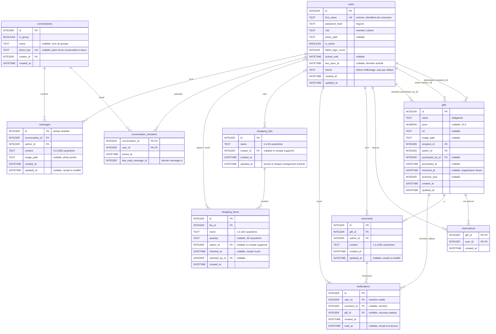

# 03 — Modèle de données

Base **SQLite**, accédée via SQLAlchemy 2, migrations Alembic. Les noms de tables et de colonnes sont en anglais, les écrans et la doc en français (glossaire ci-dessous).

## Schéma



## Glossaire

| Colonne / table | Sens métier |
|---|---|
| `users` | Membres et admin |
| `gifts` | Cadeaux |
| `gifts.recipient_id` | Destinataire (« Pour qui ? ») |
| `gifts.author_id` | Auteur. Suggestion ⇔ `author_id <> recipient_id` |
| `gifts.purchased_by_id` | Membre qui a marqué le cadeau « acheté » (RG-28) |
| `gifts.removed_at` | Suppression douce (RG-22) |
| `gifts.archived_year` | Année de clôture (RG-39) |
| `reservations` | « Je m'en occupe », plusieurs par cadeau (RG-26) |
| `comments` | Fil de discussion d'un cadeau |
| `notifications` | Notification du membre `user_id` : une mention `@Prénom` dans un commentaire (`comment_id`, RG-42) **ou** un nouveau cadeau (`gift_id`, RG-57), jamais les deux. Non lue ⇔ `read_at IS NULL` |
| `shopping_lists` | Listes de courses, partagées par tous les membres (RG-59) |
| `shopping_items` | Articles d'une liste. Pris ⇔ `checked_at IS NOT NULL`, par `checked_by_id` (RG-60) |
| `users.last_seen_at` | Dernière activité du membre, notée au plus une fois par minute (« En ligne », RG-52) |
| `users.theme` | Thème d'affichage choisi dans le profil (RG-56) : `auto`, `clair`, `sombre`, `neige`, `canneberge`, `epices`, `minuit`. La liste est dans `services/users.py`, les couleurs dans `tokens.css` |
| `conversations` | Conversation privée : à deux ou groupe (RG-46) |
| `conversations.direct_key` | `petit_id:grand_id` des deux membres : une seule conversation à deux par paire |
| `conversations.creator_id` | Créateur du groupe (renommer, retirer, RG-53) |
| `conversation_members` | Participants. Seuls eux lisent la conversation (RG-47) |
| `conversation_members.last_read_message_id` | Dernier message lu. Non lu ⇔ message d'un autre avec un `id` plus grand (RG-50, RG-51) |
| `messages` | Messages privés. `image_path` est relatif au dossier privé `media_private/`, jamais servi en statique |

## Statut d'un cadeau (calculé, non stocké)

| Statut | Condition |
|---|---|
| `disponible` | aucune réservation, `purchased_by_id IS NULL` |
| `réservé` | ≥ 1 réservation, `purchased_by_id IS NULL` |
| `acheté` | `purchased_by_id IS NOT NULL` |
| `retiré` | `removed_at IS NOT NULL` (prioritaire à l'affichage) |
| `archivé` | `archived_year IS NOT NULL` (jamais affiché côté membre) |

## DDL de référence

> La source de vérité reste les migrations Alembic. Ce SQL sert de lecture rapide.

```sql
CREATE TABLE users (
    id                 INTEGER PRIMARY KEY,
    first_name         TEXT    NOT NULL UNIQUE,
    password_hash      TEXT    NOT NULL,
    role               TEXT    NOT NULL DEFAULT 'member' CHECK (role IN ('member', 'admin')),
    photo_path         TEXT,
    is_active          BOOLEAN NOT NULL DEFAULT 1,
    failed_login_count INTEGER NOT NULL DEFAULT 0,
    locked_until       DATETIME,
    last_seen_at       DATETIME,
    theme              TEXT    NOT NULL DEFAULT 'auto',
    created_at         DATETIME NOT NULL DEFAULT CURRENT_TIMESTAMP,
    updated_at         DATETIME NOT NULL DEFAULT CURRENT_TIMESTAMP
);

CREATE TABLE gifts (
    id              INTEGER PRIMARY KEY,
    name            TEXT    NOT NULL CHECK (length(trim(name)) > 0),
    price           NUMERIC(10, 2) CHECK (price IS NULL OR price >= 0),
    url             TEXT,
    image_path      TEXT,
    recipient_id    INTEGER NOT NULL REFERENCES users(id),
    author_id       INTEGER NOT NULL REFERENCES users(id),
    purchased_by_id INTEGER REFERENCES users(id),
    purchased_at    DATETIME,
    removed_at      DATETIME,
    archived_year   INTEGER,
    created_at      DATETIME NOT NULL DEFAULT CURRENT_TIMESTAMP,
    updated_at      DATETIME NOT NULL DEFAULT CURRENT_TIMESTAMP,
    CHECK (purchased_by_id IS NULL OR purchased_by_id <> recipient_id)
);
CREATE INDEX ix_gifts_recipient ON gifts(recipient_id) WHERE archived_year IS NULL;

CREATE TABLE reservations (
    gift_id    INTEGER NOT NULL REFERENCES gifts(id) ON DELETE CASCADE,
    user_id    INTEGER NOT NULL REFERENCES users(id),
    created_at DATETIME NOT NULL DEFAULT CURRENT_TIMESTAMP,
    PRIMARY KEY (gift_id, user_id)
);

CREATE TABLE comments (
    id         INTEGER PRIMARY KEY,
    gift_id    INTEGER NOT NULL REFERENCES gifts(id) ON DELETE CASCADE,
    author_id  INTEGER NOT NULL REFERENCES users(id),
    content    TEXT    NOT NULL CHECK (length(trim(content)) BETWEEN 1 AND 1000),
    created_at DATETIME NOT NULL DEFAULT CURRENT_TIMESTAMP,
    updated_at DATETIME
);
CREATE INDEX ix_comments_gift ON comments(gift_id, created_at);

CREATE TABLE notifications (
    id         INTEGER PRIMARY KEY,
    user_id    INTEGER NOT NULL REFERENCES users(id),
    comment_id INTEGER REFERENCES comments(id) ON DELETE CASCADE,
    gift_id    INTEGER REFERENCES gifts(id) ON DELETE CASCADE,
    created_at DATETIME NOT NULL DEFAULT CURRENT_TIMESTAMP,
    read_at    DATETIME,
    UNIQUE (user_id, comment_id),
    UNIQUE (user_id, gift_id),
    CHECK ((comment_id IS NULL) <> (gift_id IS NULL))
);
CREATE INDEX ix_notifications_user ON notifications(user_id, read_at);

CREATE TABLE shopping_lists (
    id         INTEGER PRIMARY KEY,
    name       TEXT    NOT NULL CHECK (length(trim(name)) > 0),
    creator_id INTEGER REFERENCES users(id),
    created_at DATETIME NOT NULL DEFAULT CURRENT_TIMESTAMP,
    updated_at DATETIME NOT NULL DEFAULT CURRENT_TIMESTAMP
);

CREATE TABLE shopping_items (
    id            INTEGER PRIMARY KEY,
    list_id       INTEGER NOT NULL REFERENCES shopping_lists(id) ON DELETE CASCADE,
    name          TEXT    NOT NULL CHECK (length(trim(name)) > 0),
    quantity      TEXT,
    author_id     INTEGER REFERENCES users(id),
    checked_at    DATETIME,
    checked_by_id INTEGER REFERENCES users(id),
    created_at    DATETIME NOT NULL DEFAULT CURRENT_TIMESTAMP
);
CREATE INDEX ix_shopping_items_list ON shopping_items(list_id, id);

CREATE TABLE conversations (
    id         INTEGER PRIMARY KEY,
    is_group   BOOLEAN NOT NULL,
    name       TEXT,
    direct_key TEXT UNIQUE,
    creator_id INTEGER NOT NULL REFERENCES users(id),
    created_at DATETIME NOT NULL DEFAULT CURRENT_TIMESTAMP,
    CHECK ((is_group = 1 AND name IS NOT NULL AND direct_key IS NULL)
        OR (is_group = 0 AND name IS NULL AND direct_key IS NOT NULL))
);

CREATE TABLE conversation_members (
    conversation_id      INTEGER NOT NULL REFERENCES conversations(id) ON DELETE CASCADE,
    user_id              INTEGER NOT NULL REFERENCES users(id),
    joined_at            DATETIME NOT NULL DEFAULT CURRENT_TIMESTAMP,
    last_read_message_id INTEGER NOT NULL DEFAULT 0,
    PRIMARY KEY (conversation_id, user_id)
);
CREATE INDEX ix_conversation_members_user ON conversation_members(user_id);

CREATE TABLE messages (
    id              INTEGER PRIMARY KEY AUTOINCREMENT,
    conversation_id INTEGER NOT NULL REFERENCES conversations(id) ON DELETE CASCADE,
    author_id       INTEGER NOT NULL REFERENCES users(id),
    content         TEXT    NOT NULL,
    image_path      TEXT,
    created_at      DATETIME NOT NULL DEFAULT CURRENT_TIMESTAMP,
    updated_at      DATETIME,
    CHECK (length(content) <= 1000 AND (length(trim(content)) > 0 OR image_path IS NOT NULL))
);
CREATE INDEX ix_messages_conversation ON messages(conversation_id, id);
```

## Contraintes portées par le code applicatif

Ces contraintes ne sont pas exprimables simplement en SQL. Chacune doit avoir son test.

- Un réservant n'est jamais le destinataire (RG-26).
- `purchased_by_id` doit correspondre à un réservant au moment de l'achat (RG-28).
- Aucune réservation ne peut être ajoutée ou supprimée si le cadeau est acheté, retiré ou archivé.
- Un compte `admin` n'est jamais destinataire, auteur, réservant ni auteur de commentaire.
- Une notification ne vise jamais le destinataire du cadeau commenté, ni l'auteur du commentaire (RG-42, RG-43).
- Une notification de nouveau cadeau ne vise jamais l'auteur du cadeau ni le destinataire d'une suggestion (RG-57).
- Un compte `admin` n'est jamais créateur d'une liste de courses ni auteur d'un article (RG-59).
- Une conversation à deux a exactement deux participants, deux membres différents (RG-46).
- Un compte `admin` n'est jamais participant d'une conversation ni auteur d'un message (RG-46).
- Toute lecture de `conversations`, `messages` ou d'une photo vérifie que le viewer est participant (RG-47).
- `messages.id` est en `AUTOINCREMENT` : un identifiant supprimé n'est jamais réattribué, sinon « lu jusqu'au message n » serait faux.
- SQLite : activer `PRAGMA foreign_keys = ON` à chaque connexion.
